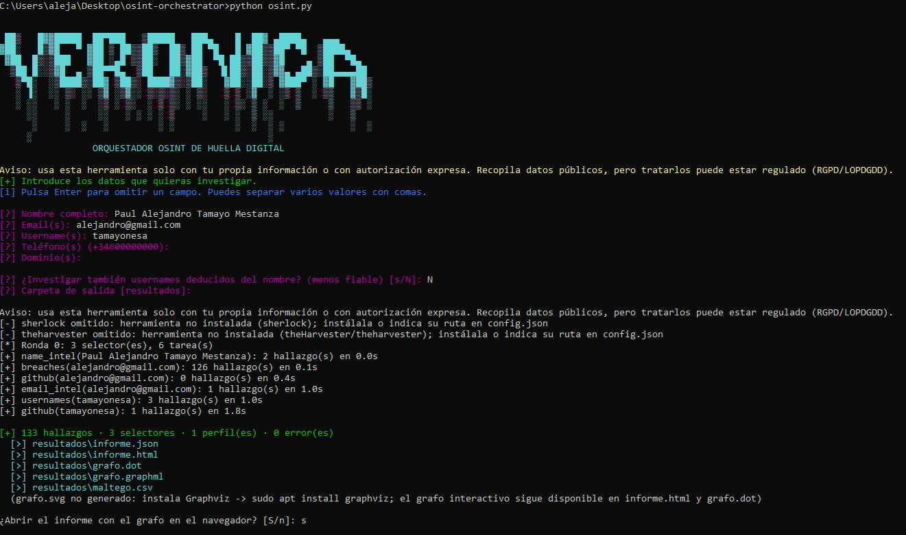
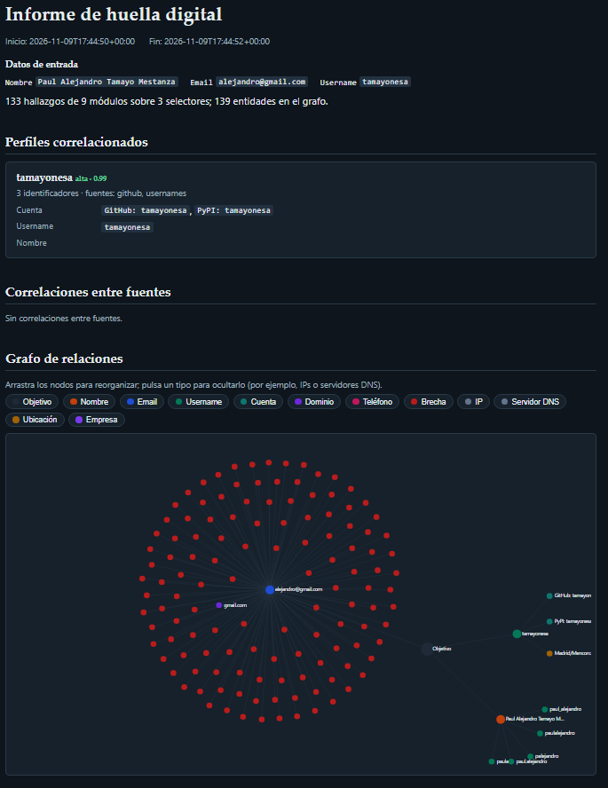

## VERONICA

```text
 ██▒   █▓▓█████  ██▀███   ▒█████   ███▄    █  ██▓ ▄████▄   ▄▄▄
▓██░   █▒▓█   ▀ ▓██ ▒ ██▒▒██▒  ██▒ ██ ▀█   █ ▓██▒▒██▀ ▀█  ▒████▄
 ▓██  █▒░▒███   ▓██ ░▄█ ▒▒██░  ██▒▓██  ▀█ ██▒▒██▒▒▓█    ▄ ▒██  ▀█▄
  ▒██ █░░▒▓█  ▄ ▒██▀▀█▄  ▒██   ██░▓██▒  ▐▌██▒░██░▒▓▓▄ ▄██▒░██▄▄▄▄██
   ▒▀█░  ░▒████▒░██▓ ▒██▒░ ████▓▒░▒██░   ▓██░░██░▒ ▓███▀ ░ ▓█   ▓██▒
   ░ ▐░  ░░ ▒░ ░░ ▒▓ ░▒▓░░ ▒░▒░▒░ ░ ▒░   ▒ ▒ ░▓  ░ ░▒ ▒  ░ ▒▒   ▓▒█░
   ░ ░░   ░ ░  ░  ░▒ ░ ▒░  ░ ▒ ▒░ ░ ░░   ░ ▒░ ▒ ░  ░  ▒     ▒   ▒▒ ░
     ░░     ░     ░░   ░ ░ ░ ░ ▒     ░   ░ ░  ▒ ░░          ░   ▒
      ░     ░  ░   ░         ░ ░           ░  ░  ░ ░            ░  ░
     ░                                           ░

             ORQUESTADOR OSINT DE HUELLA DIGITAL
```

Herramienta modular en **Python 3.10+ (solo librería estándar, sin `pip install`)** que recolecta información pública sobre una persona a partir de un nombre, email, username, teléfono o dominio. Ejecuta varios módulos en paralelo, **pivota** sobre lo que descubre (un email hallado en un commit se investiga a su vez), **correlaciona** los resultados en perfiles y genera un informe HTML/JSON con un grafo de relaciones.

> **Uso responsable.** Úsala solo sobre tu propia huella digital o con autorización expresa de la persona investigada. Aunque las fuentes son públicas, agregarlas puede constituir tratamiento de datos personales (RGPD/LOPDGDD). Los resultados pueden ser erróneos o corresponder a homónimos: verifícalos antes de sacar conclusiones.

## Inicio rápido

```bash
git clone <tu-repo> && cd osint-orchestrator

python osint.py                             # modo asistente: te pregunta los datos uno a uno
python osint.py -e persona@dominio.com      # búsqueda real por email
python osint.py -u usuario -d ejemplo.com -n "Nombre Apellido" -p +34600000001
python osint.py --list-modules              # módulos disponibles y su estado
python osint.py --web                       # interfaz web en http://127.0.0.1:8080
python -m unittest discover -s tests -v     # tests (sin red)
```

Al ejecutar `python osint.py` sin argumentos, el asistente pide nombre, email(s), username(s), teléfono(s) y dominio(s) (Enter para omitir; varios valores separados por coma), valida cada uno y, al terminar, ofrece abrir `informe.html` con el grafo en el navegador.

### Opciones principales

| Opción | Descripción |
|---|---|
| `-n`, `-e`, `-u`, `-p`, `-d` | Entradas (nombre, email, username, teléfono, dominio). Se pueden repetir y combinar. |
| `-m` / `-x` | Ejecutar solo / excluir módulos (`-m breaches,github`). |
| `--depth N` | Rondas de pivote (def. 2). `0` desactiva los pivotes. |
| `--guess` | Investiga también suposiciones (usernames derivados del nombre). Por defecto solo se listan. |
| `-f json,html,dot,svg,graphml,csv` | Formatos de salida. `-o DIR` carpeta de salida. |
| `--config config.json` | Claves de API y herramientas externas (ver `config.example.json`). |
| `--workers`, `--timeout`, `--delay` | Paralelismo, timeout y pausa mínima por host (cortesía con los servicios). |

Claves opcionales (variable de entorno o `config.json`): `HIBP_API_KEY` (HaveIBeenPwned, de pago) y `GITHUB_TOKEN` (sube el límite de la API de GitHub).

## Arquitectura

```
osint.py                    punto de entrada
orquestador/
  core.py                   Selector · Entity · Finding · Module (clase base) · Orchestrator
  runner.py                 run_scan(): construye y ejecuta todo (lo usan CLI y web)
  http.py                   cliente HTTP (rate-limit por host, caché, modo demo con fixtures)
  graph.py                  grafo, correlación, perfiles y exportaciones
  report.py                 informes JSON / HTML (+ DOT, SVG, GraphML, CSV)
  cli.py · web.py           interfaces
  modules/                  un fichero por fuente (se autodescubren)
plugins/                    tus módulos propios (se autodescubren)
```

**Flujo:** `entradas → Selector → módulos que aceptan ese tipo (en paralelo) → Findings → Entities → (pivot) nuevos Selectors → …`. Cada hallazgo declara las entidades que descubre; esas entidades son los nodos del grafo y, si se marcan `pivot=True`, la siguiente ronda de búsqueda.

### Módulos incluidos

| Módulo | Acepta | Fuente | Clave |
|---|---|---|---|
| `breaches` | email | HaveIBeenPwned + XposedOrNot | HIBP opcional (XposedOrNot no necesita) |
| `email_intel` | email | MX del dominio, correos desechables, perfil Gravatar | no |
| `usernames` | username | 18 plataformas (`data/sites.json`) | no |
| `github` | username, email | API pública de GitHub: perfil y emails de commits | opcional |
| `whois_rdap` | dominio | RDAP (sucesor de WHOIS) | no |
| `dns_records` | dominio | A/AAAA/MX/NS/TXT, SPF, DMARC vía DNS-over-HTTPS | no |
| `crtsh` | dominio | Subdominios en Certificate Transparency | no |
| `phone_info` | teléfono | Análisis offline (E.164, país, tipo de línea ES) | no |
| `name_intel` | nombre | Candidatos de username/email y enlaces de búsqueda manual | no |
| `theharvester` | dominio | **Herramienta externa** theHarvester | instalarla |
| `sherlock` | username | **Herramienta externa** Sherlock (cientos de redes) | instalarla |

Un módulo cuya herramienta o clave falta se **omite con un aviso**, nunca rompe el escaneo.

## Integrar herramientas externas

Tres niveles, de menos a más esfuerzo:

1. **theHarvester y Sherlock** funcionan solos si están en el `PATH` (o indica su ruta en `config.json → tools`). Se ejecutan sin shell, con tiempo máximo, y su salida se parsea a hallazgos.
2. **Cualquier herramienta CLI** declarada en `config.json → external_tools`, sin escribir código Python:

   ```json
   {"external_tools": [{
     "name": "mi_script", "accepts": ["email"], "parser": "json", "timeout": 60,
     "command": ["python3", "examples/custom_tool.py", "{value}"]
   }]}
   ```
   `parser` puede ser `json` (el script imprime una lista de hallazgos; contrato documentado en `modules/external.py`), `regex` (cada coincidencia pasa a ser una entidad) o `lines` (la salida cruda). Con esto se puede envolver, por ejemplo, `recon-cli` de Recon-ng o PhoneInfoga; ajusta el comando a tu instalación.
3. **Plugin Python**: deja un `.py` en `plugins/` con una clase que herede de `Module`. Se descubre solo.

**Maltego:** el grafo se exporta a `maltego.csv` (aristas con tipos de entidad `maltego.*`) para usar *Import Graph from Table*; también a GraphML (Gephi, yEd).

## Correlación

* Los nodos se identifican por *(tipo, valor normalizado)*: el mismo email, username o nombre (sin distinguir tildes) hallado por fuentes distintas converge en **un único nodo**.
* **Correlaciones:** entidades confirmadas por ≥2 fuentes que las *descubren* (no cuentan los módulos que solo recibieron el dato como entrada), username reutilizado en ≥3 plataformas, varios emails vinculados a la misma identidad.
* **Perfiles:** componentes conectados de identificadores personales (nombres, emails, usernames, cuentas, teléfonos, dominios). Las brechas, IPs y servidores DNS **no** unen perfiles (son recursos compartidos) y las suposiciones (confianza < 0,4) tampoco. La confianza del perfil es una heurística *noisy-OR* sobre la mejor evidencia de cada fuente: es una guía, no una probabilidad real.

## Salidas

| Fichero | Contenido |
|---|---|
| `informe.html` | Informe autocontenido (sin recursos externos) con grafo interactivo, modo oscuro y contenido escapado |
| `informe.json` | Resultado completo y estructurado (hallazgos, perfiles, correlaciones, grafo, estado de módulos, errores) |
| `grafo.dot` / `grafo.svg` | Graphviz (el SVG se genera si `dot` está instalado) |
| `grafo.graphml` / `maltego.csv` | Gephi/yEd · Maltego |

El grafo está en `informe.html` (interactivo: arrastra nodos, filtra por tipo) y en `grafo.svg`/`grafo.dot` (Graphviz).

## Seguridad y diseño

* Los valores de entrada se validan y se rechaza todo lo que empiece por `-` (evita inyección de argumentos en herramientas externas). Los comandos externos se ejecutan **sin shell**.
* El informe escapa todo lo que viene de Internet y solo enlaza URLs `http(s)`.
* La interfaz web escucha solo en `127.0.0.1` y exige un token por arranque.
* Pausa mínima por host, tope de selectores (`--max-selectors`) y las suposiciones no se investigan salvo `--guess`.
* Los emails *deducidos* del nombre solo se listan; nunca se consultan en brechas automáticamente.

## Limitaciones conocidas

* Instagram, X, Facebook, LinkedIn, etc. exigen login/JavaScript: para eso está la integración con Sherlock/Maigret. Algunas plataformas bloquean peticiones automáticas (403/429) y se informan como «sin respuesta fiable», no como encontradas.
* RDAP suele ocultar los contactos por RGPD; HIBP exige clave de pago; GitHub limita a 60 peticiones/hora sin token.
* El código se ha probado de extremo a extremo con tests unitarios con respuestas HTTP simuladas; **la primera ejecución contra los servicios reales conviene revisarla** (`-v`), porque los servicios pueden cambiar su formato o sus límites. Para añadir/quitar plataformas edita `orquestador/data/sites.json` o usa `extra_sites` en `config.json`.

## Docker (opcional)

```bash
docker build -t osint-orquestador .
docker run --rm -it -v "$PWD/resultados:/app/resultados" osint-orquestador
docker run --rm -p 127.0.0.1:8080:8080 osint-orquestador --web --host 0.0.0.0
```

## Ejemplo de ejecución






