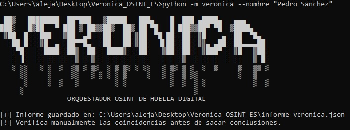

# Veronica — Orquestador OSINT de huella digital

Veronica es una herramienta modular en Python para recopilar información de fuentes públicas a partir de nombres, nombres de usuario, correos electrónicos y dominios. Los resultados se guardan en un informe JSON estructurado.

## Uso responsable

Utiliza la herramienta únicamente sobre tus propios activos, con consentimiento explícito o dentro de un alcance autorizado. Los resultados son indicios que deben verificarse manualmente. No permiten confirmar por sí solos la identidad de una persona.

## Requisitos

- Python 3.10 o superior.
- Conexión a Internet para las consultas públicas.
- Opcionales: `dig` (paquete `dnsutils` o `bind-tools`), `whois` y [Sherlock](https://github.com/sherlock-project/sherlock).

## Instalación

```bash
git clone <URL_DEL_REPOSITORIO>
cd Veronica_OSINT
python3 -m venv .venv
source .venv/bin/activate
```

Veronica no requiere dependencias Python externas.

## Ejemplos de uso

Buscar un nombre:



```bash
python3 -m veronica --nombre "Nombre Apellido"
```

Comprobar un nombre de usuario:

```bash
python3 -m veronica --usuario ejemplo
```

Analizar un correo:

```bash
python3 -m veronica --correo ejemplo@dominio.test
```

Analizar un dominio:

```bash
python3 -m veronica --dominio example.org
```

Combinar parámetros y elegir la ruta del informe:

```bash
python3 -m veronica \
  --nombre "Nombre Apellido" \
  --usuario ejemplo \
  --dominio example.org \
  --salida informes/caso.json
```

## Integración con Sherlock

Instala Sherlock siguiendo su documentación oficial. Si el comando `sherlock` está disponible en el `PATH`, puedes activar la integración:

```bash
python3 -m veronica --usuario ejemplo --sherlock
```

## Módulos

| Módulo | Descripción |
|---|---|
| `name.py` | Genera enlaces de búsqueda pública para investigación manual. |
| `username.py` | Comprueba perfiles públicos e integra Sherlock opcionalmente. |
| `email.py` | Valida el formato del correo y analiza su dominio. |
| `domain.py` | Consulta registros DNS y WHOIS si las utilidades están instaladas. |

## Informe

Por defecto, el informe se guarda en `informe-veronica.json`. Incluye la fecha UTC, los parámetros utilizados, los resultados de cada módulo y avisos sobre las limitaciones de las comprobaciones.

## Ejemplo de ejecución

```text
$ python3 -m veronica --usuario ejemplo --dominio example.org
[+] Informe guardado en: /ruta/informe-veronica.json
[!] Verifica manualmente las coincidencias antes de sacar conclusiones.
```

## Limitaciones

- La accesibilidad de un perfil no confirma que pertenezca a la persona investigada.
- La búsqueda por nombre genera enlaces; no automatiza el scraping de buscadores.
- No se consulta HaveIBeenPwned ni otras bases de datos de filtraciones.
- Los resultados DNS y WHOIS dependen de las herramientas instaladas y de la disponibilidad de los servicios.
- Los datos encontrados deben contrastarse antes de incorporarlos a un informe.

## Estructura del proyecto

```text
Veronica_OSINT/
├── README.md
├── requirements.txt
└── veronica/
    ├── __init__.py
    ├── __main__.py
    ├── cli.py
    └── modules/
        ├── __init__.py
        ├── name.py
        ├── username.py
        ├── email.py
        └── domain.py
```


